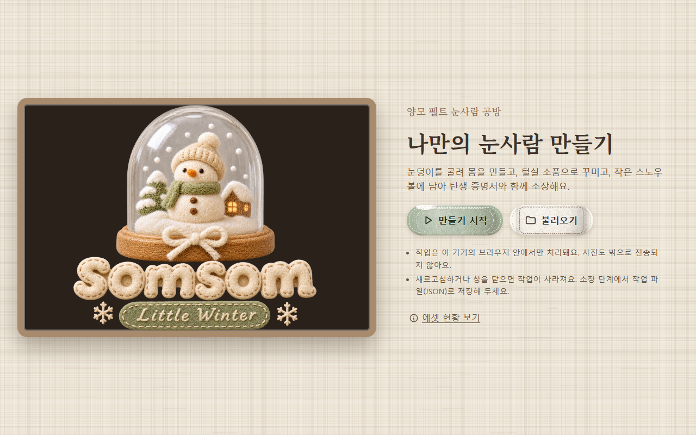
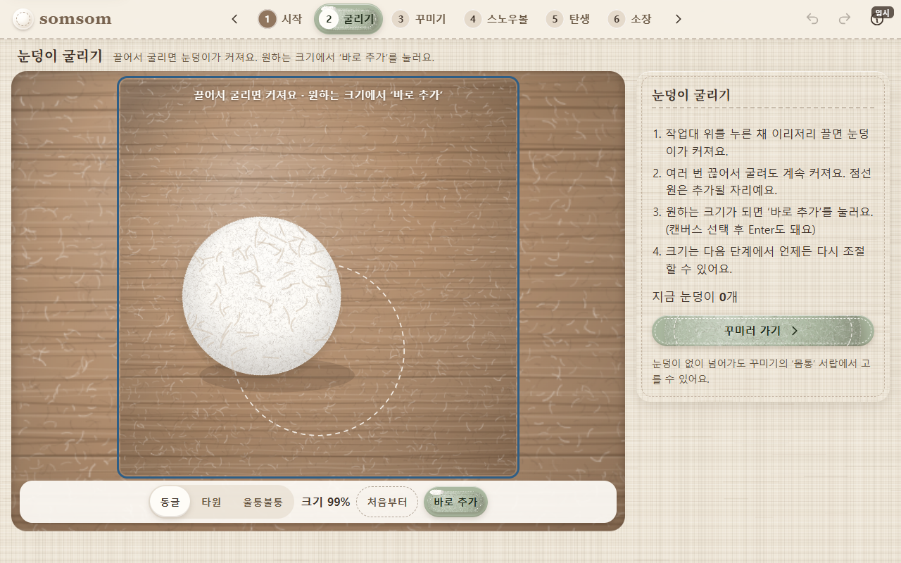
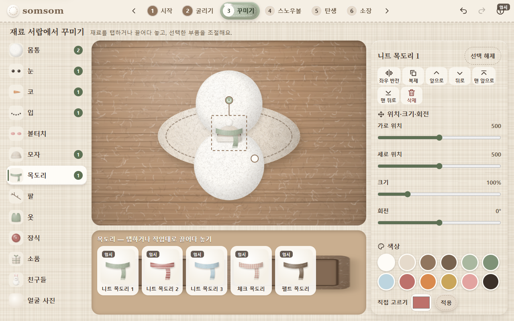
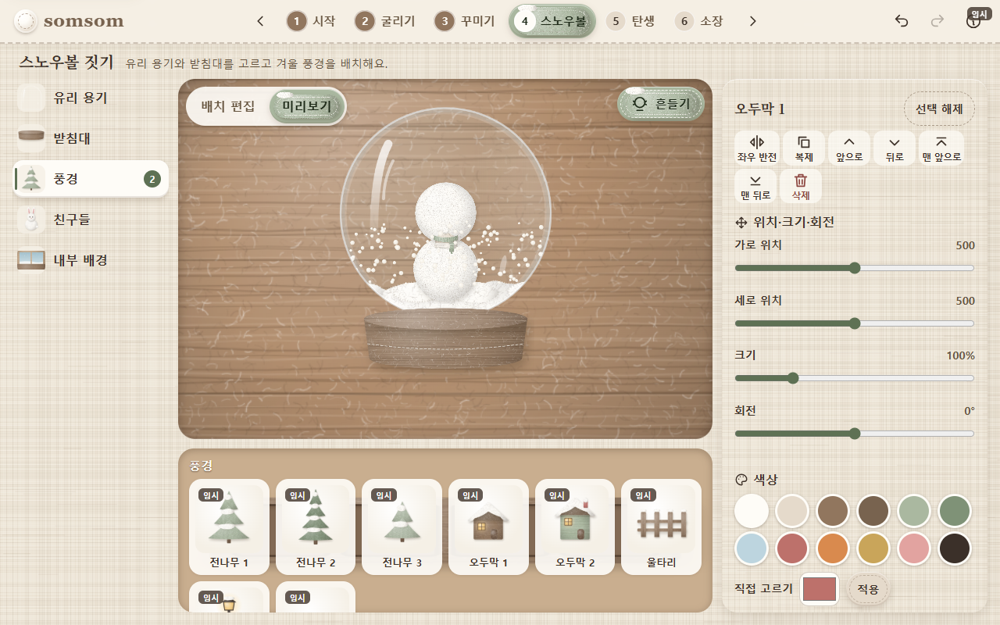
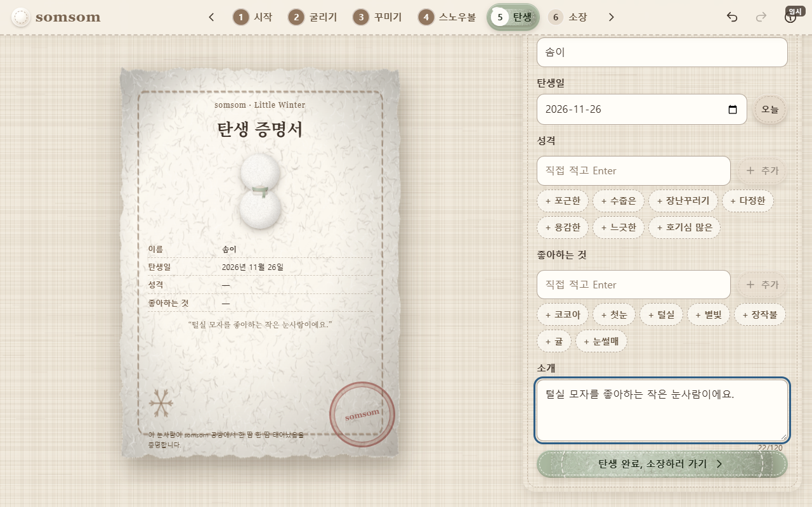
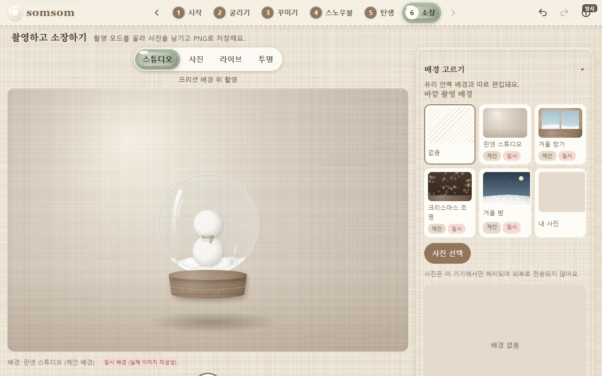
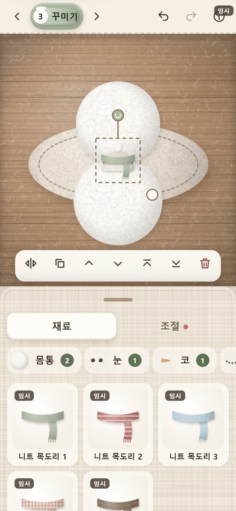
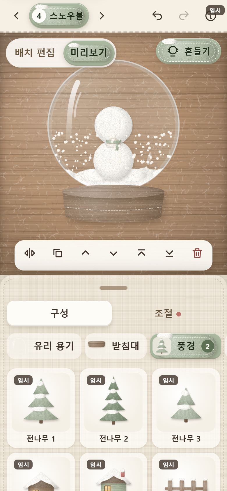
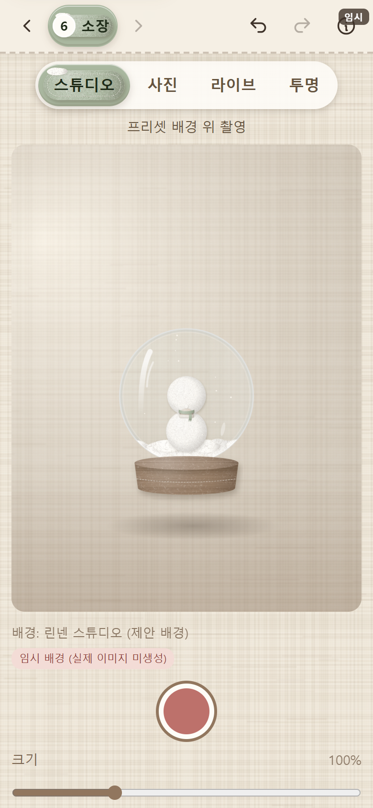

# somsom · Little Winter

양모 펠트 눈사람을 직접 굴리고 꾸며 작은 스노우볼에 담고, 탄생 증명서와 함께 소장하는 웹 공방입니다.

<p align="center"></p>

> **개발 중인 버전입니다.** 메인 로고를 뺀 이미지 에셋 86개는 아직 만들어지지 않았습니다. 지금은 Canvas로 그린 **임시 그림**이 대신 표시되고, 화면에는 '임시' 표시가 붙습니다. 임시 그림은 최종 디자인이 아닙니다.

## 화면

실제 실행 화면입니다(데스크톱 1280px, 모바일 390px). 이름은 예시이고, 재료 그림은 임시 에셋입니다.

| 시작 | 굴리기 | 꾸미기 |
|---|---|---|
|  |  |  |
| **스노우볼** | **탄생 증명서** | **소장·촬영** |
|  |  |  |

| 모바일 꾸미기 | 모바일 스노우볼 | 모바일 촬영 |
|---|---|---|
|  |  |  |

## 바로 사용하기

https://sodam-wd.github.io/somsom/ (게시 전)

설치는 필요 없습니다. 브라우저로 접속하면 바로 실행됩니다.

## 핵심 기능

1. **굴리기:** 원목 작업대를 끌어 눈덩이를 키우고, 원하는 크기에서 '바로 추가'합니다.
2. **꾸미기:** 재료 서랍에서 눈·코·입·모자·목도리 등을 골라 자유롭게 조립합니다.
   - 이동, 크기, 회전, 좌우 반전, 복제, 삭제, 앞뒤 순서를 바꿀 수 있습니다.
   - 부품마다 색을 바꿀 수 있습니다.
   - 실행 취소와 다시 실행을 지원합니다.
3. **얼굴 사진:** 원하는 사진을 넣고 자르기, 채도·밝기·대비, 부드러운 경계, 양모 질감을 조절해 펠트처럼 합성합니다. AI 변환이 아닌 2D 합성입니다.
4. **스노우볼:** 유리 용기 3종(둥근 돔·아치 돔·유리병)과 받침대를 고르고 풍경·친구를 배치합니다. '흔들기'를 누르면 눈이 날립니다.
5. **배경:** 스노우볼 안쪽 배경과 바깥 촬영 배경을 각각 따로 정합니다. 내 사진을 쓸 수도 있습니다.
6. **탄생 증명서:** 이름, 탄생일, 성격, 좋아하는 것, 소개를 적습니다.
7. **촬영:** 네 가지 모드가 있습니다.
   - 스튜디오
   - 내 사진 배경
   - 라이브 카메라: 카메라 화면 위에 작품을 2D로 겹칩니다. 공간을 인식하는 AR은 아닙니다.
   - 투명 배경
8. **저장:**
   - PNG 3종: 투명 눈사람, 스노우볼, 탄생 증명서. 정사각 1080·2048px 또는 세로 1080×1920px로 저장합니다.
   - 작업 파일(JSON)로 저장하고 다시 불러올 수 있습니다.

## 사용 방법

1. **시작:** '만들기 시작'을 누릅니다.
2. **굴리기:** 작업대를 누른 채 끌어 눈덩이를 키우고 '바로 추가'를 누릅니다. 두세 개를 쌓아 몸을 만듭니다.
3. **꾸미기:** 왼쪽 서랍에서 재료를 탭하거나 작업대로 끌어다 놓습니다. 모바일에서는 아래 서랍을 씁니다. 부품을 선택하면 조절 패널이 열립니다.
4. **스노우볼:** 유리 용기·받침대·풍경을 고르고 '흔들기'를 눌러 봅니다.
5. **탄생:** 증명서 내용을 적습니다.
6. **소장:** 촬영 모드를 고르고 셔터를 누르거나, PNG·작업 파일을 저장합니다.

언제든 위쪽 단계 표시에서 이전 단계로 돌아가 고칠 수 있습니다.

## 데이터 관리

- 모든 작업은 **이 기기의 브라우저 메모리 안에서만** 처리됩니다. 서버, 로그인, 외부 전송은 없습니다. 사진과 카메라 영상도 기기 밖으로 나가지 않습니다.
- **새로고침하거나 창을 닫으면 작업이 사라집니다.** 자동 저장은 아직 없습니다. 이어서 작업하려면 '작업 저장(JSON)'으로 파일을 남겨 두세요.
- 작업 파일(JSON)에는 **넣은 사진이 그대로 들어 있습니다.** 파일을 공유할 때 주의하세요.
- 잘못된 작업 파일을 불러오면 오류를 알려 주고, 기존 작업은 그대로 둡니다.

## 지원 환경

**확인한 환경:**
- Windows의 Chrome(데스크톱 폭 1280px)
- 같은 Chrome에서 화면 폭을 320·375·390·768px로 바꿔 본 모바일 레이아웃

**아직 확인하지 않은 환경:**
- iPhone Safari, Android Chrome 실기기
- 실제 터치 핀치·회전
- 카메라 허용 후 촬영
- 모바일 공유 창
- HEIC 사진

카메라는 HTTPS(또는 localhost)에서만 동작합니다. 권한을 거부하거나 카메라를 지원하지 않으면 '사진으로 대신하기'로 진행할 수 있습니다.

## 알려진 제한

- **에셋 미완료:** 메인 로고를 뺀 86개 에셋(꾸미기 재료 65개, 공방 UI 15종, 로고 심볼·워드마크, 촬영 배경 4종)이 아직 없어 임시 그림을 씁니다. 실제 PNG를 정해진 경로에 넣으면 코드 수정 없이 바뀝니다. 촬영 배경 4종은 제안 상태입니다.
- **GIF 미구현:** 스노우볼 GIF 저장(P1)은 아직 구현하지 않았습니다. 버튼만 '준비 중'으로 보입니다.
- **배치 위치:** 재료를 탭해 추가하면 가운데에 놓입니다. 다른 부품 뒤에 가려질 수 있으니 끌어서 옮겨 주세요(개선 중).
- **첫 화면 로딩:** 첫 방문 때 로고가 늦게 보일 수 있습니다.
- **미검증 항목:** 위 '지원 환경'의 확인하지 않은 항목은 실제 기기에서 검증하지 않았습니다.

## 개발자용 실행

```bash
npm ci
npm run dev        # 개발 서버
npm run build      # 정적 빌드 (dist/)
npm run preview    # 빌드 결과 미리보기
npm test           # 단위 테스트
```

React, TypeScript, Vite, Canvas 2D, Pointer Events를 씁니다. 빌드 결과는 상대 경로를 쓰므로 GitHub Pages 저장소 하위 경로에서도 동작합니다.

## 라이선스

미정
